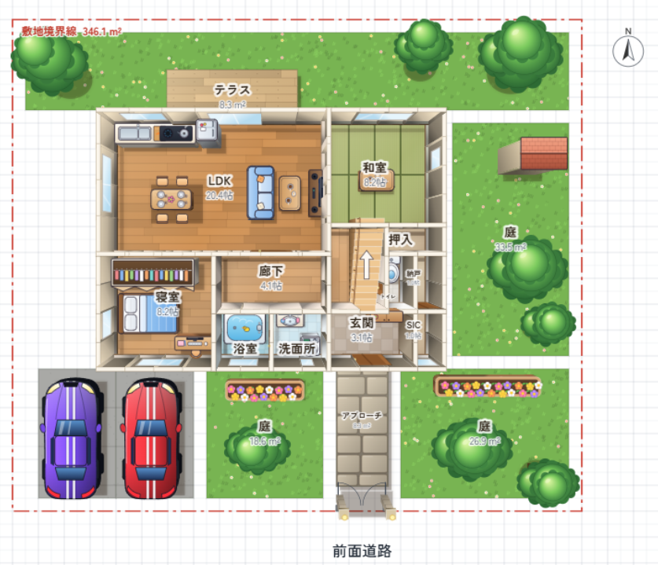
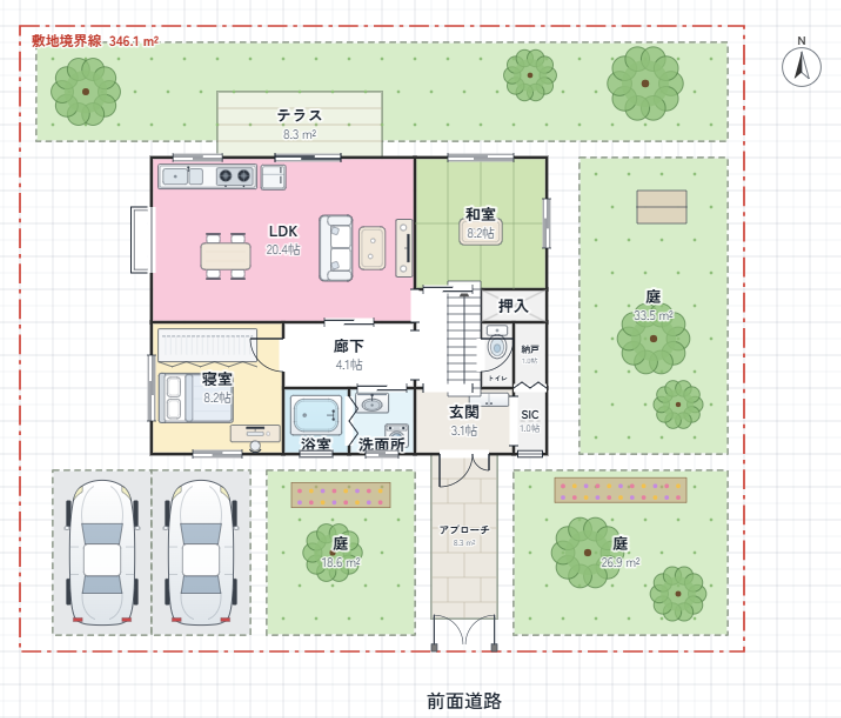

# 間取り図スタジオ（FloorPlanStudio）

部屋・家具・ドア・窓を置いて間取り図を作れるWindowsソフトです。
ボタン1つで、立体パース風の「アニメ風」表示にも切り替えられます。

## サンプル

| アニメ風 | シンプル |
|:---:|:---:|
|  |  |

## ダウンロード

[Releases](https://github.com/daigorou-addon/FloorPlanStudio/releases) から最新の `FloorPlanStudio.Setup.x.x.x.exe` をダウンロードして実行してください。

## 主な機能

- **部屋・設備・家具・ドア・窓をドラッグで配置**
  - 洋室・和室・寝室・浴室・トイレ・玄関・廊下・バルコニーなどの部屋
  - キッチン・冷蔵庫・洗濯機・浴槽・ベッド・ソファ・テーブルなどの設備・家具
  - 開き戸・引き違い戸・折れ戸、引き違い窓・掃き出し窓・出窓などの建具
  - 直階段・かね折れ階段・らせん階段・ロフトはしご・吹き抜け
  - 前面道路・駐車場・庭・塀・門などの外構、方位記号、テキスト
- **ドア・窓は壁に吸着**。窓は両端の■で長さを変更できます
- **部屋の角を斜めにカット**（角の○をドラッグ）
- **複数階に対応**（階の追加・削除）
- **3つの表示モード**：シンプル / 詳細 / アニメ風
- 壁の太さ・文字サイズ・面積表示・名前の表示/非表示、床の色の変更
- 拡大縮小・移動、元に戻す（Ctrl+Z）/ やり直し（Ctrl+Y）
- ライト / ダークテーマの切り替え
- サンプル図の表示
- 内容はアプリに自動保存されます

グリッドは1マス＝455mm（太線＝910mm）です。

## 保存・出力

| 項目 | 内容 |
|------|------|
| 保存 / 開く | `.floorplan` ファイルとして保存・読み込み |
| 画像出力 | PNG |
| 印刷 | 対応 |

## 対応言語

日本語 / English / 简体中文 / 繁體中文 / 한국어 / Español

## 作者

[Daigorou-Tools](https://daigorou-addon.github.io/daigorou-tools/)

---

# FloorPlanStudio (English)

A Windows app for creating floor plans by placing rooms, furniture, doors and windows.
With one click, you can also switch to a 3D-perspective-style "anime" view.

## Samples

| Anime style | Simple |
|:---:|:---:|
|  |  |

## Download

Download the latest `FloorPlanStudio.Setup.x.x.x.exe` from [Releases](https://github.com/daigorou-addon/FloorPlanStudio/releases) and run it.

## Features

- **Place rooms, fixtures, furniture, doors and windows by dragging**
  - Rooms: Western-style room, Japanese-style room, bedroom, bathroom, toilet, entrance, hallway, balcony, and more
  - Fixtures and furniture: kitchen, refrigerator, washing machine, bathtub, beds, sofa, tables, and more
  - Doors and windows: hinged doors, sliding doors, folding doors, sliding windows, floor-to-ceiling windows, bay windows, and more
  - Straight stairs, L-shaped stairs, spiral stairs, loft ladder, open-to-below voids
  - Exterior elements such as front road, parking, garden, fence and gate, plus a compass symbol and text
- **Doors and windows snap to walls**. Window length can be changed with the ■ handles at both ends
- **Cut room corners diagonally** (drag the ○ at the corner)
- **Multiple floors** (add and delete floors)
- **Three display modes**: Simple / Detailed / Anime style
- Adjust wall thickness, text size, area display, show/hide names, and floor colors
- Zoom and pan, undo (Ctrl+Z) / redo (Ctrl+Y)
- Light / dark theme
- Sample plan
- Your work is saved automatically in the app

The grid is 455 mm per square (bold lines = 910 mm).

## Saving and Export

| Item | Details |
|------|---------|
| Save / Open | Saved and loaded as `.floorplan` files |
| Image export | PNG |
| Print | Supported |

## Supported Languages

日本語 / English / 简体中文 / 繁體中文 / 한국어 / Español

## Author

[Daigorou-Tools](https://daigorou-addon.github.io/daigorou-tools/)
